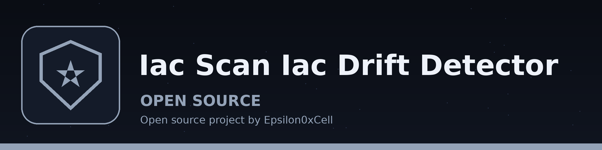

# iac-scan-IaC-Drift-Detector
Compares live cloud infrastructure state against the defined IaC configuration (e.g., Terraform state file) and reports any drift or discrepancies using `json` or `yaml` parsing. Only one combination is implemented: aws with terraform, where the tool compares the presence and absence of EC2 instances by instance ID between the Terraform state and the live EC2 inventory. Every other provider and IaC type combination is reported as not implemented, exits non-zero, and prints no report; a combination that was not compared never reports no drift. - Focused on Presence and absence of EC2 instances for aws terraform state. No resource attributes are read, so the tool says nothing about access controls, exposed secrets, or how an instance is configured.

## Install
`git clone https://github.com/ShadowStrikeHQ/iac-scan-iac-drift-detector`

## Usage
`./iac-scan-iac-drift-detector [params]`

## Parameters
- `-h`: Show help message and exit
- `--iac-type`: No description provided
- `--iac-file`: No description provided
- `--cloud-provider`: No description provided
- `--region`: No description provided
- `--output-format`: No description provided

## License
Copyright (c) ShadowStrikeHQ
